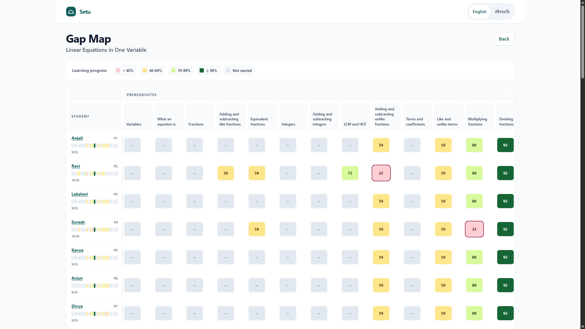
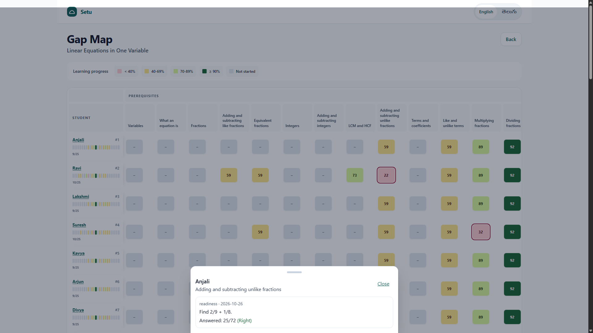
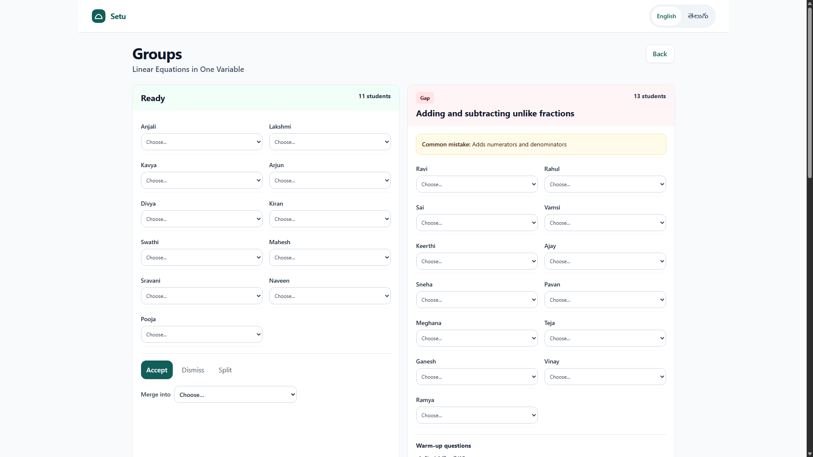
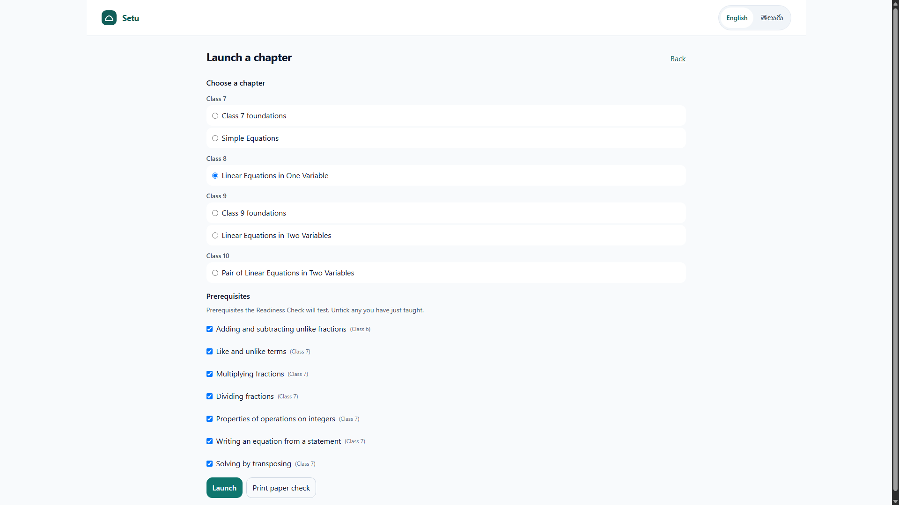
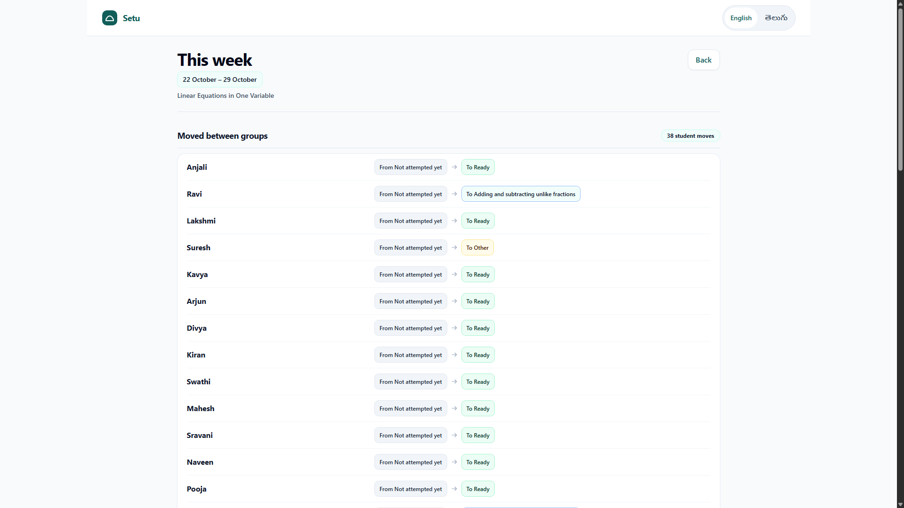
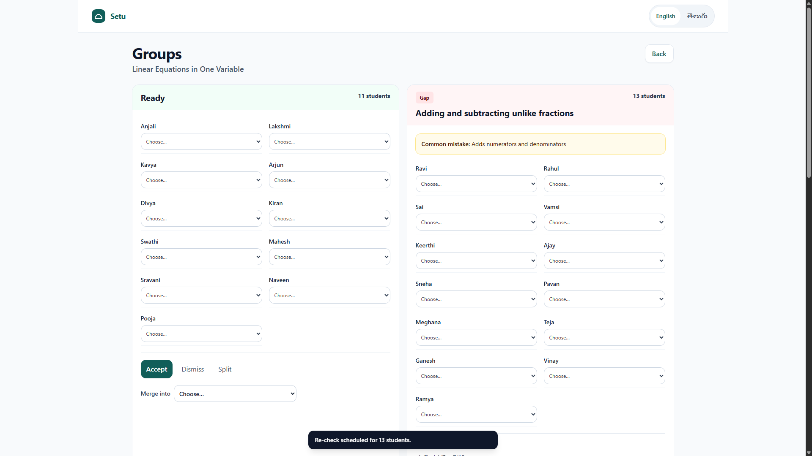

# Setu · సేతు

**Find the learning gap before the lesson starts.**

Setu is an offline-first learning system for Classes 6–10. A short Readiness Check traces mistakes through a prerequisite graph. Students get a path that fits what they know; teachers get a Gap Map and choose what to do next.

**First release:** Class 8 Mathematics, *Linear Equations in One Variable*, in English and Telugu.

[Open the live app](https://setu-3vfo.onrender.com) · [Watch the six-minute walkthrough](docs/DEMO_SCRIPT.md) · [Read the architecture](docs/ARCHITECTURE.md)

## Try the seeded demo

The in-browser demo needs no database. From the repository root:

```bash
pnpm install
pnpm content:pack
pnpm --filter @setu/web dev
```

Open [http://localhost:5173/demo](http://localhost:5173/demo). It loads a seeded Class 8B with Anjali, Ravi and 44 synthetic students, then opens the teacher Gap Map.

| Account | Sign-in |
|---|---|
| Teacher | `teacher@demo.setu.app` / `setu-demo` (or open `/demo`) |
| Anjali | `DEMO8B`, roll `1`, PIN `1111` |
| Ravi | `DEMO8B`, roll `2`, PIN `2222` |
| Class 8B, rolls 3–46 | PIN is `3000 + roll number` (roll 3: `3003`) |

### Demo mode and the live database

These are two different data sets:

| Mode | What you see |
|---|---|
| Local `/demo` | 46 students with generated learning history. Runs in the browser without an API or database. |
| API-backed app | Students and classrooms are stored in Postgres. Progress appears as students use the app. Class 8B starts with its chapter launched; Class 9A needs a teacher to launch a chapter first. |

The live database seed creates the roster, but does not create learning history for every student. Empty progress cells mean that student has not sent activity yet.

## Screenshots

Teacher workflow screenshots are in [docs/wireframes](docs/wireframes/).

| Gap Map | Evidence drawer |
|---|---|
|  |  |

| Group recommendations | Chapter launch |
|---|---|
|  |  |

| Weekly view | Re-check confirmation |
|---|---|
|  |  |

## What Setu does

- **For students:** readiness check, bilingual Learn resources, guided Solve with hints, Test, mastery and re-checks.
- **For teachers:** classroom Gap Map with evidence, suggested groups, paper entry, chapter launch, student actions and weekly progress.
- **Offline-first:** the student PWA stores events on the device and syncs when connected.
- **One learning engine:** the same TypeScript engine powers the app, API and simulation.

## Evaluation

The simulation uses 1,000 rule-based learners. These numbers are simulated—not classroom results.

| Planted gaps | Recall | Precision | Gap Map root cause | Median questions |
|---|---:|---:|---:|---:|
| Single | 86.2% | 66.4% | 47.4% | 12 |
| Double | 79.2% | 80.5% | 60.0% | 12 |

See the full [evaluation report](docs/EVALUATION.md) and [known decisions and limits](docs/DECISIONS.md). Telugu content is a first draft and needs review by a Telugu-medium mathematics teacher.

## Develop

```bash
pnpm install
pnpm content:validate
pnpm build
pnpm typecheck
pnpm lint
pnpm test
```

To run the API locally, start Postgres with `docker compose up -d`, then run `pnpm dev`. See [deployment notes](docs/DEPLOYMENT.md) for the API-backed setup.

## Project map

```text
apps/web          React + Vite student and teacher PWA
apps/api          Fastify API, Prisma and PostgreSQL
packages/engine   Pure TypeScript learning and readiness engine
packages/content  Concept graphs, bilingual questions, resources and pack builder
packages/shared   API types and client interface
docs/             Architecture, decisions, evaluation and demo materials
```

## Further reading

| Document | Purpose |
|---|---|
| [Architecture](docs/ARCHITECTURE.md) | Engine, content, data model and API |
| [Build plan](docs/BUILD_PLAN.md) | Completed phases and optional stretch work |
| [Decisions](docs/DECISIONS.md) | Product and technical choices, known limits |
| [Demo script](docs/DEMO_SCRIPT.md) | Six-minute walkthrough |
| [Presenter guide](docs/PRESENTER_GUIDE.md) | Setup and presentation notes |
| [Deployment](docs/DEPLOYMENT.md) | Hosting, database, onboarding and support |
| [Scaling](docs/SCALING.md) | Adding chapters, languages, boards and subjects |
| [Wireframes](docs/wireframes/) | Teacher workflows and classroom routine |

## Team

Karthik Chiluveru · Code Kernel '26, X-Kernel, GRIET, with Canvas Classes.
