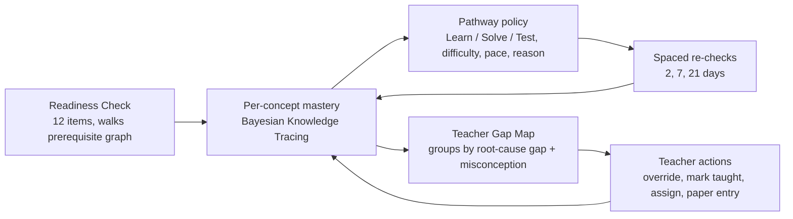

# Setu · సేతు

**Adaptive learning that finds the gap before the chapter begins.**
Code Kernel '26 (X-Kernel, GRIET, with Canvas Classes) · Decode round: **rank 1, 94.3/100** · Build round in progress.

Setu is a teacher-centred, offline-first adaptive learning system for Classes 6 to 10. Before a teacher starts a chapter, every student takes a ten-minute **Chapter Readiness Check** that walks backwards through a prerequisite concept graph (reaching into Class 6 and 7) and pinpoints the exact earlier concept and misconception blocking them. Each student then gets their own Learn, Solve and Test pathway, and the teacher gets a class **Gap Map** with students grouped by the prerequisite they are missing, with the wrong answers as evidence. The teacher decides; Setu diagnoses, practises and re-checks.

First version: Class 8 Mathematics, *Linear Equations in One Variable*, in English and Telugu, on a shared Android phone without continuous internet, with the concept graph already spanning Classes 6 to 10.

## Start here

| If you are... | Read |
|---|---|
| Judging or reviewing | [Decode submission](docs/hackathon/02-decode-submission.md), then [ARCHITECTURE.md](docs/ARCHITECTURE.md) |
| A coding agent or developer | [AGENTS.md](AGENTS.md), [ARCHITECTURE.md](docs/ARCHITECTURE.md), [BUILD_PLAN.md](docs/BUILD_PLAN.md) |
| Looking for the evaluator follow-ups | Scalability: [SCALING.md](docs/SCALING.md) · Deployment and training: [DEPLOYMENT.md](docs/DEPLOYMENT.md) · Teacher wireframes: [docs/wireframes/](docs/wireframes/) (Phase 6) |

## Repository map

```
packages/engine    @setu/engine   pure TS: concept graph, BKT, readiness check, pathway policy, re-checks, Gap Map grouping
packages/content   @setu/content  concept graph JSON (Classes 6 to 10), bilingual questions and resources, validator, pack builder
packages/shared    @setu/shared   API DTOs and the ApiClient interface
apps/web           student + teacher PWA (React, Vite, Tailwind, Dexie, Workbox); /demo runs everything in-browser
apps/api           Fastify + Prisma + PostgreSQL: auth, packs, idempotent event sync, teacher views
docs/              architecture, build plan, decisions, deployment, evaluation, scaling, wireframes, hackathon docs
```

## Quick start

```bash
pnpm install
pnpm build               # content packs, the demo classroom (apps/web/public/demo/seed.json) and the apps
pnpm dev                 # web on :5173, api on :3000 (needs `docker compose up -d` for Postgres)
pnpm test                # engine, content, api, web tests
```

Open `http://localhost:5173/demo` for the seeded classroom (Anjali, Ravi and 44 synthetic students) without any backend: it signs the demo teacher in and opens the Gap Map. For the offline demo use the production build: `pnpm build` then `pnpm --filter @setu/web preview`.

| Demo sign-in | |
|---|---|
| Teacher | `teacher@demo.setu.app` / `setu-demo` |
| Anjali | classroom `DEMO8B`, roll `1`, PIN `1111` |
| Ravi | classroom `DEMO8B`, roll `2`, PIN `2222` |
| Roll 3 to 46 | classroom `DEMO8B`, roll `n`, PIN `3000 + n` |

The six-minute walkthrough is [docs/DEMO_SCRIPT.md](docs/DEMO_SCRIPT.md).

## What works today

- **Student (phone, offline):** sign-in and shared-phone profiles with hashed PINs, Readiness Check (up to 12 questions, walking back into Classes 6 and 7), home card with the reason for the next step, Learn with a Telugu/English toggle, Solve with hints and the three-level ladder, Test, re-check and verification.
- **Teacher:** sign-in, classrooms, Gap Map with evidence drawer, groups with warm-up questions (accept, dismiss, move, merge, split), mark taught, assign, override with note, extension lock, launch a chapter with prerequisite trimming and a printable paper check.
- **Demo mode:** every screen runs on `LocalDemoApiClient`, the same engine functions the API uses.
- **Not yet:** progress screen, sync and the API, paper entry, weekly view, simulation report. See [docs/BUILD_PLAN.md](docs/BUILD_PLAN.md).

Telugu content is a first draft and needs review by a Telugu-medium maths teacher.

## How it works in one diagram



## Status

See the checkboxes in [docs/BUILD_PLAN.md](docs/BUILD_PLAN.md). CI: GitHub Actions (`.github/workflows/ci.yml`), mirrored on GitLab CI.

## GitHub

The repository's final home is GitHub. During the event it is developed on GitLab and push-mirrored to GitHub so both stay identical; see [docs/DECISIONS.md](docs/DECISIONS.md).

## Team

Karthik Chiluveru (team `mr.karthik258`). Problem statement by X-Kernel, GRIET, Hyderabad, in collaboration with Canvas Classes.
