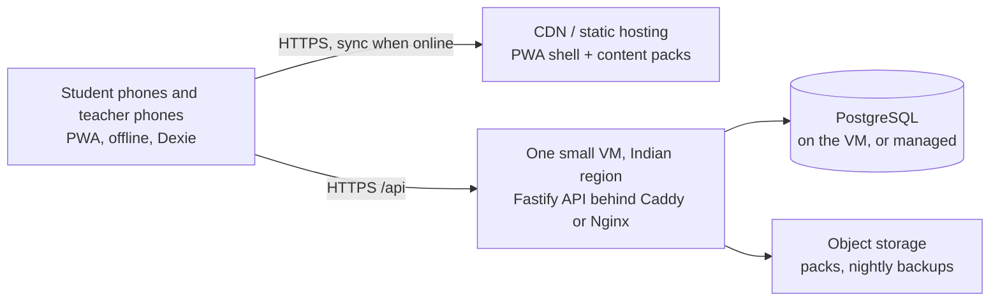

# Deployment plan

How Setu would run for real schools after the hackathon: what to host, what it costs, how a school is brought on, how teachers are trained and supported, and what is not solved yet. Figures are planning estimates in INR at the time of writing, not quotes; check current provider pricing before committing.

## 1. Reference deployment

- **One VM in an Indian region** (2 vCPU, 4 GB RAM to start) runs the Fastify API (`apps/api`) behind a TLS reverse proxy. The API is stateless apart from Postgres, so a second VM can be added behind a load balancer later without code changes.
- **PostgreSQL** on the same VM for a pilot; a managed Postgres instance from five schools upwards, so backups, patching and failover are the provider's job.
- **Static hosting / CDN** for the PWA build (`apps/web/dist`) and the content packs. Packs are immutable per `packVersion`, so they cache well and are downloaded once per device.
- **Object storage** for pack archives and database backups.
- **No runtime AI and no third-party analytics.** The engine runs on the phone and in the API; nothing is sent elsewhere (AGENTS.md).

Why this size is enough: a student generates a few hundred events a week at roughly 300 bytes each, and the API only inserts events and replays one student at a time. At 25 schools (about 10,000 students) that is under 5 GB of events a year and well under one request per second on average, peaking at the start of periods.

## 2. Monthly running cost (INR, estimates)

Assumptions: 400 students and 10 teachers per school; one Class 8 chapter live at a time; sync a few times a day; Indian-region cloud list prices rounded up; GST included in the figures; devices, internet and staff time are the school's and not included.

| Item | 1 school (pilot) | 5 schools | 25 schools |
|---|---|---|---|
| VM for the API (2 vCPU / 4 GB; 4 vCPU / 8 GB at 25) | 2,500 | 2,500 | 6,000 |
| PostgreSQL | on the VM (0) | managed, small: 4,000 | managed, medium with standby: 10,000 |
| Object storage and backups | 200 | 400 | 1,200 |
| Static hosting / CDN for PWA and packs | 0 to 500 | 500 | 1,500 |
| Domain, TLS, uptime monitoring | 300 | 300 | 500 |
| **Total per month** | **about 3,500** | **about 7,700** | **about 19,200** |
| Per student per month | about 8.75 | about 3.85 | about 1.90 |

One-off costs not in the table: printing the teacher quick card and paper Readiness Checks (about 2 rupees a page), and the trainer's travel for the first session.

## 3. School onboarding checklist

Owner: the school's Setu coordinator (usually the maths head of department) with one Setu team member.

1. **Agreement and consent.** The school signs the data agreement; consent is collected *through the school* in its usual way (circular to parents), stating the only student data kept: first name, roll number, class, language and a hashed PIN. No phone numbers, no photos, no surnames.
2. **Accounts.** Setu creates the school, the classrooms (class and section) and teacher accounts; the coordinator gets a coordinator login.
3. **Classroom codes and PINs.** Each classroom gets a short code; each student a roll number and a 4-digit PIN, printed on a slip the teacher hands out. PINs are stored only as salted hashes.
4. **Devices.** Check that shared phones or the lab machines run a current Chrome or Edge; install the PWA to the home screen.
5. **Pack download day.** On a day with internet (school Wi-Fi or a teacher's hotspot), each device opens Setu once and downloads the chapter packs; the home card shows "Downloaded for offline". After this, students can work without internet; events sync whenever a connection appears.
6. **First launch.** The teacher launches the chapter in class, trims any prerequisite just taught, and prints the paper Readiness Check for students without a device.
7. **Week-one review.** The coordinator and Setu look at the Gap Map and the weekly view together and note any problems.

## 4. Teacher training plan

- **Session 1, 90 minutes, in school, before the first chapter.**
  - 15 min: why a Readiness Check, and what the Gap Map means (with the demo classroom).
  - 30 min: hands-on as a student on a phone: sign in, Readiness Check, Learn, Solve, Test.
  - 30 min: hands-on as a teacher: launch, trim prerequisites, read the Gap Map and the evidence drawer, accept or change groups, mark taught, override with a note.
  - 15 min: paper check and paper entry for students without devices; questions.
- **Follow-up 1, 30 minutes, end of week one:** read the class's own Gap Map together; plan the warm-up for the largest group.
- **Follow-up 2, 30 minutes, after the first re-checks:** did the taught groups pass their re-checks; when to override; using the weekly view.
- **One-page quick card** (English and Telugu) kept in the staff room: the five-minute-before-class routine (open the Gap Map, look at the top group, take its three warm-up questions, mark taught after class).

## 5. Support model

- **Level 1, the school coordinator:** sign-in problems, forgotten PINs (reset by the teacher), devices that have not downloaded the pack.
- **Level 2, Setu support:** a shared support group with the coordinators, answered within one school day; a short form for content errors (a wrong answer key or a poor Telugu translation goes to the content reviewer).
- **Level 3, engineering:** sync failures, data corrections and outages. Rejected sync events are kept with their reason and never silently dropped, so problems can be traced.
- **Releases** go out outside school hours; packs are versioned, so a content fix reaches devices on their next sync without breaking work in progress.

## 6. Backup and data retention

- **Events are the source of truth.** Everything else (mastery, re-checks, groups) is rebuilt from them by the engine, so the backup that matters is the event table.
- **Backups:** nightly `pg_dump` to object storage, kept 30 days; weekly copies kept 12 weeks; a restore is tested once a term. Managed Postgres adds point-in-time recovery from five schools upwards.
- **On the device:** events wait in Dexie until the server accepts them; a phone that is lost before syncing loses only its unsynced work.
- **Retention:** student events are kept for the school year plus one year for the teacher's records, then deleted or anonymised. A school can ask for a student's or the whole school's data to be exported or deleted at any time.
- **Access:** teachers see only their own classrooms; coordinators see their school; the API checks this on every request.
- **Encryption.** In transit: TLS everywhere (the reverse proxy terminates HTTPS; HTTP redirects). At rest: use a managed Postgres with storage encryption enabled (the default on major providers) or an encrypted disk on the VM; backups go to object storage with server-side encryption and a bucket that is not public. Passwords and PINs are stored only as salted scrypt hashes. On the device, data sits in the browser's IndexedDB for the signed-in profiles only; the browser does not encrypt it, so shared phones rely on the device lock and the profile PIN (see Honest limits).

## 7. Honest limits

- At the time of writing the API (BUILD_PLAN Phase 4) and real sync (3.10) are not finished; the demo runs entirely on the device with `LocalDemoApiClient`. The deployment above is the plan for the production path.
- Content covers one full chapter (Class 8 Linear Equations in One Variable) and skeleton chapters for Classes 6, 7, 9 and 10. Telugu text is a first draft and needs review by a Telugu-medium maths teacher before use with students.
- Mastery thresholds and learning parameters are defaults from the literature, not yet fitted to Indian classroom data.
- Shared phones rely on the PIN and the profile picker; a student who knows another's PIN could answer for them. On-device data is not encrypted by the app.
- Coordinators can currently open individual student pages; the submission's plan is aggregates only for coordinators, which is a planned change.
- Costs above are estimates for planning, and do not include devices, internet, or the people who run the pilot.
